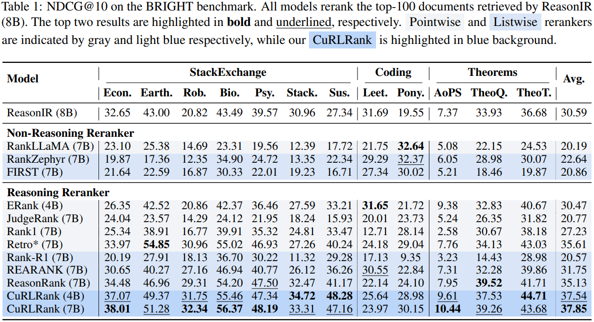
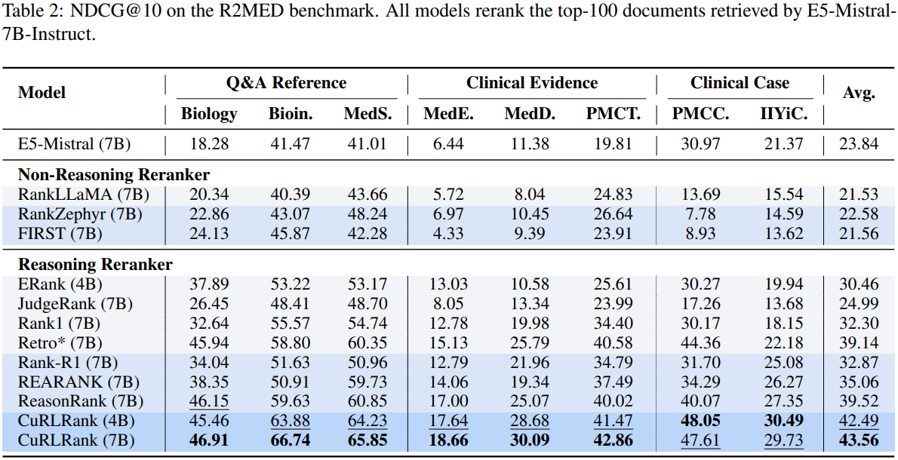

# CuRLRank: Adaptive Curriculum Reinforcement Learning for Reasoning-Intensive Reranking


[](https://github.com/)
[](https://www.python.org/)
[](https://developer.nvidia.com/cuda-toolkit)

This repository contains the official implementation of the paper **"CuRLRank: Adaptive Curriculum Reinforcement Learning for Reasoning-Intensive Reranking"**. 

> > [!NOTE]
> We have released key experimental code. The full codebase will be released soon.
>
> **Update (October 13, 2026):** Our paper has been accepted to the **EMNLP 2026 Main Conference**.

## 1. Environments 🛠️

* **OS:** Ubuntu 22.04.4 LTS
* **GPU:** NVIDIA RTX 6000 Ada
* **CUDA:** 12.4
* **Python:** 3.11.15
* **Torch:** 2.8.0

```bash
conda create -n CuRLRank python=3.11
pip install torch==2.8.0 torchvision==0.23.0 torchaudio==2.8.0 --index-url https://download.pytorch.org/whl/cu128
```

### 1.1 Supervised Fine-Tuning (SFT)

```bash
cd train/LlamaFactory
pip install -e . && pip install -r requirements/metrics.txt -r requirements/deepspeed.txt
pip install wandb
```

### 1.2 Adaptive Curriculum Reinforcement Learning (CuRL)

```bash
cd train/verl
USE_MEGATRON=0 bash scripts/install_vllm_sglang_mcore.sh
pip install --no-deps -e .
```

**Note:** FlashAttention may fail to install automatically. In that case, download the prebuilt wheel from the following release and install it manually:

[flash_attn-2.8.3](https://github.com/Dao-AILab/flash-attention/releases/download/v2.8.3/flash_attn-2.8.3+cu12torch2.8cxx11abiTRUE-cp311-cp311-linux_x86_64.whl)

For example:

```bash
pip install $YOUR_FLASH_ATTN_PATH
```

### 1.3 Evaluation

```bash
pip install sglang==0.5.5
pip install -U FlagEmbedding
pip install faiss-cpu
pip install pytrec_eval
pip install ftfy
pip install beir
```

**Note:** The automatic installation of `pytrec_eval` may fail because of network connectivity issues. In such cases, please follow the tutorial below to install it manually:

[pytrec_eval install tutorial](https://blog.csdn.net/xiaodingdang1022/article/details/141434030)

**Note:** These environments are independent of each other. If you only need to run evaluations, simply create an environment with Python 3.11 and PyTorch 2.8.0, then install the evaluation dependencies listed above. There is no need to install the packages required for supervised fine-tuning or adaptive curriculum reinforcement learning.

## 2. Datasets and models 🧠

### 2.1 Download datasets 🗂️

Download all datasets from [CuRLRank_data](https://huggingface.co/datasets/chichitutu/CuRLRank/tree/main), where:

- **`deepseek-r1_sft.json`** is used for the first-stage Supervised Fine-Tuning (SFT).
- **`train.parquet`** and **`val.parquet`** are used for the second-stage Adaptive Curriculum Reinforcement Learning (CuRL).
- The **`text`** folder contains the queries, corpora, and qrels for the three benchmark datasets.
- The **`retrieval`** folder contains the initial retrieval results generated by different retrievers on the three benchmarks, which are used for reranking evaluation.

Please organize the downloaded files as follows:

```text
./train/LlamaFactory/data/
└── deepseek-r1_sft.json

./train/verl/data/
├── train.parquet
└── val.parquet

./evaluation/data/
├── text/
└── retrieval/
```

Specifically:

- Place **`deepseek-r1_sft.json`** under `./train/LlamaFactory/data/`.
- Place **`train.parquet`** and **`val.parquet`** under `./train/verl/data/`.
- Place both the **`text`** and **`retrieval`** folders under `./evaluation/data/`.

### 2.2 Download models 🤖

Download the model from either:

- [CuRLRank-4B (Hugging Face)](https://huggingface.co/chichitutu/CuRLRank-4B/tree/main)
- [CuRLRank-4B (ModelScope)](https://modelscope.cn/models/chichitutu/CuRLRank-4B/files)

Then place the downloaded model files under the following directory:

```text
./evaluation/model/
└── CuRLRank-4B/
```

Specifically:

- Download the complete **CuRLRank-4B** model from either Hugging Face or ModelScope.
- Place all model files in `./evaluation/model/CuRLRank-4B/`.

## 3. Training 🚀

### 3.1 Supervised Fine-Tuning (SFT)

For the supervised fine-tuning stage, you need to modify the file `./train/LlamaFactory/examples/train_full/qwen3_full_sft.yaml`:

```yaml
### model
model_name_or_path: {YOUR_BACKBONE_MODEL_PATH}
trust_remote_code: true

### method
stage: sft
do_train: true
finetuning_type: full
deepspeed: examples/deepspeed/ds_z3_config.json

### dataset
dataset: deepseek-r1_sft
template: qwen3
cutoff_len: 8192
overwrite_cache: true
preprocessing_num_workers: 16
dataloader_num_workers: 4

### output
output_dir: {YOUR_MODEL_SAVE_PATH}
logging_steps: 10
# save_steps: 500
plot_loss: true
overwrite_output_dir: true
save_only_model: true
report_to: wandb

### train
per_device_train_batch_size: 1
gradient_accumulation_steps: 8
learning_rate: 1e-5
num_train_epochs: 5.0
lr_scheduler_type: cosine
warmup_ratio: 0.1
bf16: true
ddp_timeout: 180000000
resume_from_checkpoint: null
save_strategy: epoch
gradient_checkpointing: true

### eval
# eval_dataset: alpaca_en_demo
# val_size: 0.1
# per_device_eval_batch_size: 1
# eval_strategy: steps
# eval_steps: 500
```

After replacing `{YOUR_BACKBONE_MODEL_PATH}` and `{YOUR_MODEL_SAVE_PATH}` with your own paths, start supervised fine-tuning by running the following command in the `LlamaFactory` directory:

```bash
nohup bash train_full.sh > train_full.log 2>&1 &
```

------

### 3.2 Adaptive Curriculum Reinforcement Learning (CuRL)

For the reinforcement learning stage, you only need to modify the file `./train/verl/train_grpo.sh`:

```bash
set -x
export VLLM_ATTENTION_BACKEND=FLASH_ATTN
export HYDRA_FULL_ERROR=1
project_dir={YOUR_VERL_PATH}
TRAIN_FILES=${project_dir}/data/train.parquet
VAL_FILES=${project_dir}/data/val.parquet
SFT_MODEL_PATH=${project_dir}/model/{YOUR_SFT_MODEL_PATH}
SAVING_PATH=${project_dir}/model/{YOUR_SAVE_PATH}

python3 -m verl.trainer.main_ppo \
    algorithm.adv_estimator=grpo \
    data.train_files=${TRAIN_FILES} \
    data.val_files=${VAL_FILES} \
    data.train_batch_size=32 \
    data.val_batch_size=64 \
    data.shuffle=False \
    data.max_prompt_length=8192 \
    data.max_response_length=1536 \
    data.filter_overlong_prompts=True \
    data.truncation=error \
    data.AdaCuSample.enable=True \
    data.AdaCuSample.beta=0.68 \
    data.AdaCuSample.eta=0.02 \
    data.AdaCuSample.d_min=0 \
    data.AdaCuSample.d_max=5 \
    actor_rollout_ref.model.path=$SFT_MODEL_PATH \
    actor_rollout_ref.actor.optim.lr=1e-5 \
    actor_rollout_ref.model.use_remove_padding=True \
    actor_rollout_ref.actor.ppo_mini_batch_size=8 \
    actor_rollout_ref.actor.ppo_micro_batch_size_per_gpu=1 \
    actor_rollout_ref.actor.use_kl_loss=True \
    actor_rollout_ref.actor.kl_loss_coef=0.001 \
    actor_rollout_ref.actor.kl_loss_type=low_var_kl \
    actor_rollout_ref.actor.entropy_coeff=0 \
    actor_rollout_ref.model.enable_gradient_checkpointing=True \
    actor_rollout_ref.actor.fsdp_config.param_offload=False \
    actor_rollout_ref.actor.fsdp_config.optimizer_offload=False \
    actor_rollout_ref.rollout.log_prob_micro_batch_size_per_gpu=4 \
    actor_rollout_ref.rollout.tensor_model_parallel_size=1 \
    actor_rollout_ref.rollout.name=vllm \
    actor_rollout_ref.rollout.max_model_len=10240 \
    actor_rollout_ref.rollout.gpu_memory_utilization=0.5 \
    actor_rollout_ref.rollout.n=5 \
    actor_rollout_ref.rollout.max_num_batched_tokens=10240 \
    actor_rollout_ref.ref.log_prob_micro_batch_size_per_gpu=4 \
    actor_rollout_ref.ref.fsdp_config.param_offload=True \
    algorithm.use_kl_in_reward=False \
    trainer.critic_warmup=0 \
    trainer.logger=['console','wandb'] \
    trainer.project_name='curlrank' \
    trainer.experiment_name='grpo' \
    trainer.default_local_dir=$SAVING_PATH \
    trainer.n_gpus_per_node=4 \
    trainer.nnodes=1 \
    trainer.save_freq=18 \
    trainer.test_freq=18 \
    trainer.total_epochs=1 $@
```

Specifically, replace the following placeholders:

- `{YOUR_VERL_PATH}`: the path to your `verl` project directory.
- `{YOUR_SFT_MODEL_PATH}`: the path to the SFT model obtained from the previous stage.
- `{YOUR_SAVE_PATH}`: the directory where the reinforcement learning checkpoints will be saved.

After completing the modifications, start Adaptive Curriculum Reinforcement Learning by running the following command in the `verl` directory:

```bash
nohup bash train_grpo.sh > train_grpo.log 2>&1 &
```

> **Note:** Our reward function is implemented in `./train/verl/verl/utils/reward_score/ranking.py`. Feel free to customize it according to your own ranking objectives or reward design.

## 4. Evaluation 📏

During the evaluation stage, you only need to modify the file `./evaluation/scripts/CuRLRank-4B.sh`:

```bash
ROOT_DIR={YOUR_EVALUATION_PATH}

reranker_models=("CuRLRank-4B")

for reranker_model in "${reranker_models[@]}"; do

    echo "================================================="
    echo "Running reranker: ${reranker_model}"
    echo "================================================="

    eval_name="bright"
    retriever_model="reasonir-8b"
    retriever_data="bright_reasonir-8b_top100"

    echo "   ================================================="
    echo "   Running benchmark: ${eval_name}"
    echo "   ================================================="

    dataset_names=('biology' 'earth_science' 'economics' 'robotics' 'psychology'
                     'stackoverflow' 'sustainable_living' 'leetcode' 'pony' 'aops'
                     'theoremqa_questions' 'theoremqa_theorems')

    dataset_dir="${ROOT_DIR}/data/text/${eval_name}"
    embedder_path="${ROOT_DIR}/model/${retriever_model}"
    reranker_path="${ROOT_DIR}/model/${reranker_model}"
    retriever_results_dir="${ROOT_DIR}/data/retrieval/${retriever_data}"
    reranker_results_dir="${ROOT_DIR}/data/reranking/${retriever_data}/${reranker_model}"
    log_dir="${ROOT_DIR}/logs/${retriever_data}/${reranker_model}"

    mkdir -p "${reranker_results_dir}"
    mkdir -p "${log_dir}"

    python main.py \
        --eval_name "${eval_name}" \
        --dataset_dir "${dataset_dir}" \
        --retriever_results_dir "${retriever_results_dir}" \
        --reranker_results_dir "${reranker_results_dir}" \
        --dataset_names "${dataset_names[@]}" \
        --search_top_k 2000 \
        --overwrite True \
        --k_values 1 10 100 \
        --embedder_name_or_path "${embedder_path}" \
        --embedder_model_class custom \
        --reranker_name_or_path "${reranker_path}" \
        --reranker_model_class sglang-reasoning \
        --rerank_top_k 100 \
        --reranker_sample_k 1 \
        --reranker_batch_size 2048 \
        --reranker_sglang_tp_size 1 \
        --reranker_sglang_dp_size 4 \
        --reranker_sglang_seed 42 \
        --reranker_sglang_context_length 12288 \
        --reranker_max_new_tokens 1536 \
        --reranker_enable_thinking False \
        --reranker_enable_full_parallelism False \
        > "${log_dir}/${eval_name}.log" 2>&1
done
```

Replace `{YOUR_EVALUATION_PATH}` with the path to your evaluation directory. You may also modify `reranker_models`, `retriever_model`, and `retriever_data` according to your evaluation setup.

After completing the configuration, run the following command to start evaluation:

```bash
nohup bash scripts/CuRLRank-4B.sh > logs/run.log 2>&1 &
```

The final reranking results will be saved in: `./evaluation/data/reranking/`

## 5. Performance 🏆




